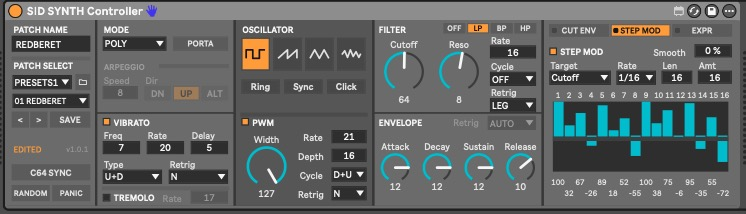

# SID SYNTH Controller for Ableton Live

A Max for Live device for editing, automating and storing sounds on
[SID SYNTH](https://sid.lukhash.com/), LukHash's synthesizer for the Commodore 64,
over MIDI.



- Every sound setting SID SYNTH accepts over MIDI on one panel, as Live
  parameters you can automate and map, using SID SYNTH's default CC map.
- Banks are native C64 `.SLO` files, so SID SYNTH's own preset banks and any
  bank saved on the C64 work directly, and banks you make go back to the C64.
- Saving to any slot of your banks; the sound is stored with the Live Set and
  sent to the C64 when the set opens.
- A RANDOM button that rolls new, playable sounds.
- Live-side layers SID SYNTH doesn't have: a cutoff envelope, a 16-step
  modulator locked to Live's beat grid, and velocity, aftertouch, mod-wheel,
  pitch-bend and key tracking mapped to sound parameters.

This is an independent project, not made by or affiliated with LukHash. SID
SYNTH is LukHash's free bonus disk for the *Neon Airlines* album; get it, and
its manual, from LukHash.

## Using it

1. Download a release and unzip it. You get one folder, `SID SYNTH Controller`.
2. Install it into your Live User Library from Live's browser: select **User
   Library** in the browser's sidebar, open `Presets` › `MIDI Effects`, and drag
   the whole `SID SYNTH Controller` folder from Finder (or Explorer) onto the
   `Max MIDI Effect` folder in the list. Live copies the folder with all its
   files. Drag the folder, not just the `.amxd`, and drop it on a folder in the
   list, not on the sidebar.
3. Drag **SID SYNTH Controller** from there onto a MIDI track whose MIDI To
   reaches your C64's MIDI interface.

Don't load the `.amxd` straight from Downloads: dropped on a track or on Live's
icon, it runs from where it sits and Live copies nothing, so the device breaks
if that folder moves. The [user guide](docs/USER_GUIDE.md)
covers setup and every feature; [hardware setup](docs/HARDWARE_SETUP.md)
describes one complete working rig (TeensyROM, Ultimate 64, a USB MIDI
interface).

Requires Ableton Live 12 with Max for Live (Max 9), and SID SYNTH with a MIDI
interface on the C64.

## Getting SID SYNTH's preset banks into Live

The device doesn't include LukHash's presets; you copy them from your own SID
SYNTH disk. Banks are ordinary C64 files, the same `.SLO` files SID SYNTH saves.

1. Get the SID SYNTH disk image (`sidsynth.d64`) from LukHash.
2. Copy `PRESETS1.SLO` to `PRESETS5.SLO` off the disk image with a C64 disk
   tool, as the SID SYNTH manual suggests: DirMaster on Windows, droiD64 on Mac or
   Linux. (With Node.js and this repository: `node tools/extract_d64.js
   sidsynth.d64 out/` extracts every file into `out/`.) Some tools add `.prg` to
   the name; rename them to `PRESETS1.SLO` and so on.
3. Put them in the `SID SYNTH Banks` folder in your Live User Library, under
   `Presets/MIDI Effects/Max MIDI Effect/`, where Live keeps presets for Max
   MIDI effects. With the User Library in its default place that is
   `~/Music/Ableton/User Library/Presets/MIDI Effects/Max MIDI Effect/SID SYNTH Banks`
   on a Mac and `Documents\Ableton\User Library\Presets\MIDI Effects\Max MIDI Effect\SID SYNTH Banks`
   on Windows. If you moved the User Library (Live's Settings > Library), the
   device uses the folder you chose. The easiest way to find it is the folder
   button beside the bank menu, which opens it. The device creates the folder the
   first time it loads, and lists any bank you put there straight away.

Pick `PRESETS1` in the bank menu and the factory sounds are there. A new device
starts on PRESETS1 slot 1 when it finds it. Banks you save on the C64 come across
the same way, and banks you make in Live go back to the C64's disk with the
same tools.

`NEW BANK…` in the bank menu creates a bank. To rename or delete one, do it in
the folder (the folder button opens it); the bank menu updates at once.

### Load the same bank on the C64

SID SYNTH holds one bank at a time, and its screen shows patch names from that
bank. The device can't load a bank onto the C64 or read which one is loaded:
picking a slot sends a Program Change for the slot number, then every setting.
So the C64 always *plays* the sound on the panel, but the name it shows is
whatever sits in that slot of the bank it has loaded. If you're using
`PRESETS2` in Live while the C64 has `PRESETS1` loaded, the C64 shows
PRESETS1's names for PRESETS2's sounds.

For the names to match, load the same bank on the C64 (from SID SYNTH's disk
menu) as the one selected in the bank menu. A bank you made or changed in Live
has to be copied to the C64's disk first (see above). This affects only the
C64's display. The sound, and the Live Set that stores it, are right either way.

## Building

The device is generated from source by Node.js (18 or later, no dependencies):

```sh
npm run build    # writes dist/SID SYNTH Controller/
npm run verify   # checks the build
npm test         # tests the controller and the bank-file helper
```

See [developing](docs/DEVELOPING.md) for tests, trying builds in Live and
releasing, and [architecture](docs/ARCHITECTURE.md) for how the device works.

```text
src/device/   code that runs inside Live (controller, panel logic, palette, bank files)
src/build/    the generator that writes the Max patch
test/         Node tests
docs/         user guide, architecture, MIDI and file-format references
```

## Reference

- [MIDI protocol and CC map](docs/MIDI_PROTOCOL.md)
- [.SLO bank format](docs/PRESET_FORMAT.md)
- [Features and limits](docs/FEATURES_AND_LIMITATIONS.md)
- [Panel design](docs/UI_DESIGN.md) and [Max for Live style notes](docs/MODULE_STYLE_GUIDE.md)
- [Changelog](CHANGELOG.md)

## License

MIT, see [LICENSE](LICENSE). SID SYNTH, its presets and its manual belong to
LukHash and are not part of this repository.
